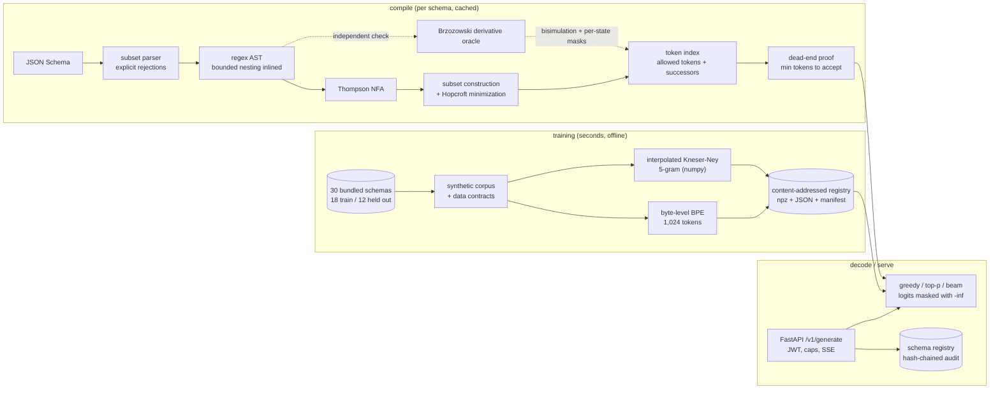

# grammar-constrained-decoder

Compiles a subset of JSON Schema into a minimal DFA with a precomputed token-transition index, so a
locally trained language model emits schema-valid JSON on every generation. An independent
Brzozowski-derivative oracle checks that every token mask is exact. Everything (corpus, byte-level
BPE tokenizer, Kneser-Ney 5-gram model, compiler, decoder, API) runs offline on a CPU in seconds,
with no model downloads and no torch.

## Problem

"Please answer in JSON" plus a retry loop is unreliable and wastes tokens, and most engineers use
constrained decoding as a black box. Doing it correctly means:

- **token boundaries**: tokens such as `}}`, `","` or `":{"` span several grammar symbols, so a
  first-character check is wrong; every byte of every token has to be checked;
- **nesting** without an unbounded stack, and **state explosion** in the automaton;
- **hostile schemas**: compilation takes attacker-controlled input (inline schemas), so it needs
  hard limits, and a schema `pattern` must never reach a backtracking regex engine;
- **termination**: a mask that only checks "this prefix is still completable" can burn the whole
  token budget inside a string and stop mid-document;
- **distortion**: masking and renormalizing token by token changes the model's distribution,
  which is rarely measured.

This repository implements each of those from first principles and tests the invariants with
property-based tests, an independent oracle and benchmarks.

## Architecture



**Compiler.** `schema/ir.py` parses the supported subset (see [SCHEMA_SUPPORT.md](SCHEMA_SUPPORT.md))
and rejects everything else with a JSON Pointer and a reason. `schema/lower.py` produces one
byte-level regex for compact canonical JSON: members in declaration order, canonical string escapes,
integer and decimal ranges lowered to digit-level languages (`schema/numeric.py`), string lengths
counted in code points, patterns from the in-repo ECMA subset parser (`automata/pattern.py`)
translated into the JSON-escaped encoding and intersected with the length language. Nesting is
bounded (default depth 6); recursive `$ref`s are unrolled to that depth ([ADR 0002](docs/adr/0002-bounded-nesting-as-a-regular-language.md)).
`automata/nfa.py` and `automata/dfa.py` implement Thompson's construction, subset construction over
byte equivalence classes, product automata for intersection and Hopcroft minimization with a
canonical renumbering, all charged to a budget of NFA states, DFA states and wall-clock time.

**Token index.** For every live DFA state, every token's bytes are walked through the transition
table (vectorized with numpy), recording allowed tokens and successor states
([ADR 0003](docs/adr/0003-precomputed-token-index-over-the-minimal-dfa.md)). A reverse breadth-first
search gives the fewest tokens from each state to acceptance; the compiler refuses a grammar if any
state reachable at a token boundary cannot finish. Compiled grammars are cached in memory and on
disk (npz, keyed by schema hash, tokenizer hash and limits).

**Decoder.** Greedy, nucleus (top-p) and beam search over the language model's log-probabilities,
with disallowed tokens set to `-inf`. EOS is allowed only in accepting states, and with `r` tokens
left only tokens that can still reach acceptance in `r - 1` more are offered, so every generation
ends in a valid document within `max_tokens` ([ADR 0006](docs/adr/0006-canonical-output-and-budget-aware-masks.md)).

**Oracle.** `automata/oracle.py` rebuilds the language with Brzozowski derivatives, independently of
the NFA/DFA code, walks the product of DFA states and derivatives (a bisimulation, so a clean walk
proves the DFA exact) and recomputes every mask and successor of the token index
([ADR 0004](docs/adr/0004-independent-derivative-oracle.md)).

**Model.** An interpolated modified Kneser-Ney 5-gram over BPE token ids, trained in numpy on a
synthetic corpus of 2,160 prompted JSON documents plus 600 template sentences
([ADR 0005](docs/adr/0005-kneser-ney-n-gram-model.md), [MODEL_CARD.md](MODEL_CARD.md)). It is weak on
purpose: claims here concern validity, exactness, overhead and distortion, not semantic quality.

**Service.** `POST /v1/generate` (JSON or Server-Sent Events) with a registered `schema_id` or an
inline `schema`; `POST /v1/schemas` (admin scope, audited); `GET /v1/schemas[/{id}]`; `/healthz`,
`/readyz` (model loaded and hash-verified, registry audit chain valid) and `/metrics`
(`tokens_per_second`, `mask_latency_seconds`, `index_cache_hit_ratio`, `compile_seconds`,
`compile_rejections_total`, `output_validity_ratio`, `prompt_length_psi`).

Layout:

```text
src/grammar_constrained_decoder/
  automata/   charset, regex AST, pattern parser, NFA, DFA (Hopcroft), derivative oracle, limits
  schema/     subset parser (IR), numeric ranges, lowering, canonical serialization, sampler, validation
  lm/         byte-level BPE tokenizer, Kneser-Ney 5-gram
  decoding/   token index, compiler + cache, decoder, distortion study
  training/   corpus generation, pipeline (train, register, verified load)
  serving/    API, schema registry, concurrency caps, metrics, service
  core/ ml/   shared baseline: settings, logging, auth, rate limits, audit log, registry, drift
bench/        validity, exactness, distortion, performance, micro-benchmarks
tests/        unit + integration (property-based with hypothesis)
```

## Quickstart

Requirements: [uv](https://docs.astral.sh/uv/) and Python 3.12. No GPU, no network after `uv sync`.

```bash
uv sync --frozen
uv run python tasks.py demo    # trains, compiles, decodes with/without constraints, streams SSE
uv run python tasks.py check   # ruff, mypy --strict, pytest + coverage, bandit, pip-audit, baseline
uv run python tasks.py bench   # every bench/ script against bench/thresholds.json
```

On Windows with a small repository drive, keep the environment elsewhere first:
`$env:UV_PROJECT_ENVIRONMENT = "C:/Users/<you>/.venvs/grammar-constrained-decoder"`.

Run the service:

```bash
uv run grammar-constrained-decoder train --workdir var/model          # ~3 s, writes var/model/registry
export APP_JWT_SECRET="$(python -c 'import secrets; print(secrets.token_urlsafe(48))')"
TOKEN="$(uv run grammar-constrained-decoder issue-token --sub alice --scope generate)"
uv run grammar-constrained-decoder serve &
curl -s -H "Authorization: Bearer $TOKEN" -H "Content-Type: application/json" \
     -d '{"prompt": "Q: a geographic point\ngeo_point:\n", "schema_id": "geo_point", "max_tokens": 64}' \
     http://127.0.0.1:8000/v1/generate
curl -sN -H "Authorization: Bearer $TOKEN" -H "Content-Type: application/json" \
     -d '{"schema": {"type": "object", "properties": {"ok": {"type": "boolean"}}, "required": ["ok"]}, "stream": true}' \
     http://127.0.0.1:8000/v1/generate
```

Compile a schema file and print its automaton statistics:
`uv run grammar-constrained-decoder compile my_schema.json`.

Containers: `docker compose up --build` builds a non-root, read-only image that trains the model
at build time and stores registry state in a named volume. Container build, smoke test (health and
readiness), trivy scan and SBOM run in CI (`.github/workflows/ci.yml`, job `docker`); they were not
run locally while building this repository.

## Results

All numbers below were copied from real runs of the bench scripts on one machine: Windows 10
(10.0.19045), Intel64 Family 6 Model 158 (6 logical CPUs), Python 3.12.14, CPU only, no network.
Each script trains the corpus, tokenizer and 5-gram model from scratch into a temporary directory
first (about 3 s) and fails with `--check` if a metric crosses `bench/thresholds.json`. CI runs
all five (job `bench`); locally `uv run python tasks.py bench` does the same. Wall-clock times:
validity 44 s, exactness 111 s, distortion 9 s, performance 20 s, micro-benchmarks 9 s.

### Validity: constrained vs unconstrained vs 3 retries

`uv run python bench/bench_validity.py --check`: 1,000 nucleus-sampled generations (top-p 0.95,
temperature 1.0, `max_tokens` 256) on the 12 held-out schemas the model never saw; validity means
`json.loads` succeeds and `jsonschema` (Draft 2020-12) accepts the value.

| held-out schema | n | constrained | unconstrained | + 3 retries | greedy c/u |
|---|---:|---:|---:|---:|---|
| invoice | 84 | 100.0% | 0.0% | 0.0% | ok/x |
| vital_signs | 84 | 100.0% | 0.0% | 0.0% | ok/x |
| shipment | 84 | 100.0% | 0.0% | 0.0% | ok/x |
| job_posting | 84 | 100.0% | 0.0% | 0.0% | ok/x |
| category_tree | 83 | 100.0% | 0.0% | 0.0% | ok/x |
| feature_flag | 83 | 100.0% | 0.0% | 0.0% | ok/x |
| game_score | 83 | 100.0% | 0.0% | 0.0% | ok/x |
| air_quality | 83 | 100.0% | 0.0% | 0.0% | ok/x |
| library_loan | 83 | 100.0% | 0.0% | 0.0% | ok/x |
| support_ticket | 83 | 100.0% | 0.0% | 0.0% | ok/x |
| hotel_booking | 83 | 100.0% | 0.0% | 0.0% | ok/x |
| geo_point | 83 | 100.0% | 0.0% | 0.0% | ok/x |

```text
generations: 1000.0
constrained_valid_ratio: 1.0
unconstrained_valid_ratio: 0.0
unconstrained_3_retries_valid_ratio: 0.0
constrained_tokens_per_generation: 57.3
unconstrained_tokens_per_generation: 31.0
retry_tokens_per_generation: 124.9
greedy_constrained_valid_schemas: 12.0
greedy_unconstrained_valid_schemas: 0.0
seen_schema_unconstrained_valid_ratio: 0.0
held_out_seconds: 37.5
```

The unconstrained baseline is weak on purpose, and this result says as much about the 5-gram as
about masking: with a four-token memory it mixes fields from different schemas, so it produced no
valid document even on the 18 schemas it was trained on (0 of 360 samples), and three retries
spend four times the tokens for nothing. The claim that matters is the left column: 1,000 of
1,000 constrained generations valid, by construction rather than by luck.

### Mask exactness, completeness, dead ends, DFA vs `re`

`uv run python bench/bench_exactness.py --check` (2,000 derandomized hypothesis schemas, the real
1,024-token vocabulary; 5 generated schemas have an empty language and are rejected at compile
time with `empty_language`, the other 1,995 are checked):

```text
schemas: 1995.0
rejected_empty_language: 5.0
dfa_states: 59295.0
token_reachable_states: 57300.0
token_decisions: 58617900.0
allowed_tokens: 2003247.0
equivalence_pairs: 62288.0
mask_mismatches: 0.0
equivalence_mismatches: 0.0
instances: 5331.0
completeness_failures: 0.0
instance_generation_skipped: 0.0
exactness_seconds: 94.9
dead_end_schemas_checked: 50.0
dead_end_failures: 0.0
re_comparisons: 40000.0
re_disagreements: 0.0
mean_dfa_states: 29.7
total_seconds: 110.3
```

- **Exactness:** for every one of the 1,995 grammars, the derivative oracle's bisimulation walk
  (62,288 DFA-state/derivative pairs) found no disagreement, and at all 57,300 states reachable at
  a token boundary the allowed-token sets and successors matched the index: 58.6 million
  (state, token) decisions, 0 mismatches.
- **Completeness:** 5,331 `hypothesis-jsonschema` instances, canonically serialized, all accepted.
- **No dead ends:** all 30 bundled and 20 tiny schemas compile with the dead-end proof.
- **DFA vs `re`:** 500 generated patterns (trusted, generated by the script) x 40 strings, full
  match and search: 40,000 comparisons, 0 disagreements.

### Distortion of masked sampling

`uv run python bench/bench_distortion.py --check`: 20 tiny schemas whose token languages are
enumerated exactly. `P(. | valid)` is the model conditioned on validity (ideal constrained
sampler), `Q` the distribution masked, locally renormalized sampling actually draws from. KL is
KL(P(. | valid) || Q) in nats; "TV samples" compares 300 real decoder samples with the exact `Q`.
Enumeration and sampling use a 32-token budget; the longest valid string among the 20 schemas is
20 bytes (`{"a":false,"b":null}`), so the budget excludes no tokenization.

| schema | strings | token seqs | valid mass | KL string | KL token | greedy = mode | TV samples |
|---|---:|---:|---:|---:|---:|---|---:|
| bool | 2 | 12 | 4.52e-09 | 0.1798 | 2.7150 | no | 0.038 |
| null | 1 | 5 | 2.26e-09 | 0.0000 | 2.2663 | yes | 0.000 |
| color | 3 | 10 | 1.92e-19 | 1.4518 | 2.4557 | no | 0.047 |
| answer | 3 | 7 | 2.61e-17 | 0.9876 | 3.1228 | no | 0.025 |
| digit | 10 | 10 | 3.84e-07 | 0.0016 | 0.0016 | yes | 0.111 |
| percent | 100 | 152 | 1.95e-06 | 1.1777 | 1.2426 | no | 0.227 |
| offset | 11 | 11 | 2.38e-07 | 0.1166 | 0.1166 | yes | 0.049 |
| ab_word | 7 | 7 | 2.43e-13 | 4.0235 | 4.0235 | no | 0.034 |
| abc_code | 12 | 12 | 1.52e-15 | 6.3915 | 6.3915 | no | 0.068 |
| ok_flag | 2 | 48 | 6.74e-12 | 0.0013 | 0.0956 | yes | 0.033 |
| small_id | 5 | 40 | 1.11e-04 | 0.0109 | 0.0203 | yes | 0.057 |
| bool_pair | 7 | 157 | 2.99e-13 | 3.7686 | 3.7692 | no | 0.048 |
| bits | 14 | 14 | 9.78e-16 | 5.3332 | 5.3332 | no | 0.050 |
| maybe_bool | 3 | 17 | 6.78e-09 | 0.1410 | 2.5866 | no | 0.019 |
| optional_pair | 6 | 1029 | 6.28e-08 | 5.6833 | 5.7073 | no | 0.014 |
| priority | 3 | 16 | 2.91e-17 | 0.5984 | 2.6192 | no | 0.022 |
| digit_string | 11 | 11 | 2.46e-13 | 5.9507 | 5.9507 | no | 0.070 |
| log_level | 2 | 768 | 2.97e-06 | 0.0750 | 0.1006 | no | 0.000 |
| small_ints | 21 | 21 | 3.01e-13 | 5.5228 | 5.5228 | no | 0.074 |
| teen | 11 | 22 | 3.71e-07 | 0.0328 | 0.2642 | yes | 0.064 |

```text
schemas: 20.0
kl_string_mean: 2.0724
kl_string_median: 0.793
kl_string_max: 6.3915
kl_token_mean: 2.7153
greedy_is_mode_ratio: 0.3
sampled_tv_max: 0.227
kl_string_exceeds_kl_token: 0.0
```

Masking is not a neutral operation: the mean string-level KL is 2.07 nats, and greedy constrained
decoding returned the most likely valid string (under the model conditioned on validity) for only
6 of 20 schemas. Six of the seven schemas with a string-level KL above 3.7 nats get less than
1e-12 of the unconstrained model's mass on valid output: when the model rarely goes where the
grammar allows, the mask forces it through continuations it considers unlikely, and local
renormalization skews most. Low valid mass alone does not predict it (`color`, at 1.9e-19, has a
KL of 1.45). The TV column is a
check of the decoder against the exact `Q` (sampling noise: 300 draws, up to 100 strings), not a
distortion measure.

### Overhead, compile time and hostile schemas

`uv run python bench/bench_performance.py --check` (mask overhead over constrained greedy and
top-p decoding of every held-out schema; cold compiles of all 30 bundled schemas; stress cases
with a 2 s compile timeout):

```text
mask_tokens_measured: 6984.0
mask_p50_us: 5.8
mask_p95_us: 16.9
mask_p99_us: 24.4
lm_step_p50_us: 32.7
compile_cold_median_s: 0.184
compile_cold_max_s: 0.82
compile_memory_hit_ms: 0.296
compile_disk_hit_ms: 23.5
stress_cases: 10.0
stress_accepted: 0.0
stress_max_seconds: 2.093
```

Compile time vs schema size (excerpt of the 30-row table, smallest, median-sized and largest
schemas; cold compile = parse, lower, NFA, DFA, minimize, token index, dead-end proof):

| schema | canonical bytes | DFA states | index entries | cold compile (s) |
|---|---:|---:|---:|---:|
| category_tree | 199 | 2532 | 216718 | 0.684 |
| feature_flag | 330 | 147 | 15619 | 0.026 |
| library_loan | 342 | 85 | 1201 | 0.014 |
| user_profile | 370 | 645 | 108685 | 0.194 |
| calendar_event | 491 | 3139 | 335346 | 0.761 |
| invoice | 599 | 2645 | 315949 | 0.82 |
| order | 726 | 842 | 111328 | 0.239 |

Compile cost tracks DFA states times vocabulary size (the index walk), not schema bytes: a
recursive 199-byte `category_tree` costs as much as the 599-byte `invoice`.

| stress case | rejection reason | seconds |
|---|---|---:|
| deep_nesting_200 | depth | 0.0 |
| enum_10000 | enum_size | 0.0 |
| pattern_5000_chars | pattern_length | 0.0 |
| exponential_dfa | dfa_states | 0.15 |
| nested_counters | timeout | 2.093 |
| max_length_1e9 | repeat_bound | 0.0 |
| bound_1e40 | number_digits | 0.0 |
| object_500_properties | properties | 0.0 |
| any_of_5000 | schema_size | 0.013 |
| backreference | pattern | 0.001 |

Per-token mask overhead (fetching the budget-aware mask and applying it to the logits) has a
median of 5.8 us and a p95 of 16.9 us, against a median of 32.7 us for one step of the numpy
5-gram (no neural model is measured here). The micro-benchmarks
(`uv run python bench/bench_baseline.py --check`, p95): cached mask fetch and apply 3.3 us, one
LM step 38.7 us, compile from the memory cache 240 us, cold compile of `invoice` 0.90 s, DFA match
of a 10 KB ReDoS-style input 3.0 ms (linear, no backtracking).

## Security

Threats, controls and the tests that prove them are in [docs/THREAT_MODEL.md](docs/THREAT_MODEL.md);
every claim below links to evidence in [CLAIMS.md](CLAIMS.md).

- **Validity is not safety.** The decoder guarantees schema-valid JSON, not true, authorized or
  harmless content. A prompt can still steer which valid document is produced. Authorize every
  effect of the output downstream, as for any untrusted input.
- **Hostile schemas.** Parsed only by the in-repo parser (no eval, local `$ref` only, unsupported
  keywords rejected explicitly). Compilation enforces limits on depth, schema size, properties,
  enum size, literal and pattern length, repetition counts, number digits, NFA states, DFA states
  and token-index entries, plus a cooperative wall-clock timeout; every rejection has a typed
  reason and a metric. Patterns are matched by DFA in linear time, and output validation swaps
  `jsonschema`'s `pattern` implementation for the DFA, so Python's `re` never sees a client pattern.
- **Access.** HS256 JWTs (pinned algorithm, required claims, bounded lifetime, fail closed without
  a secret) with a `generate` scope for decoding and a `schemas:admin` scope for registration.
  `/metrics` needs an operator API key. Per-subject rate limits, non-blocking global and
  per-client concurrency caps, and caps on `max_tokens`, prompt length and inline schema size.
- **Integrity.** Schema registrations (and rejected attempts) are appended to a hash-chained audit
  log; a stored schema that no longer matches its audited hash is refused and fails `/readyz`.
  Model counts and tokenizer load from npz (`allow_pickle=False`) and JSON only after the registry
  and the run manifest hashes verify.
- **Privacy.** Prompts and outputs are never logged: log lines carry lengths, truncated SHA-256
  digests, the schema label, token counts and timings.
- CI: ruff, mypy --strict, pytest with an 85% coverage floor, bandit, semgrep with repo rules,
  pip-audit, gitleaks, hadolint, trivy and a syft CycloneDX SBOM; base images pinned by digest.
  See [SECURITY.md](SECURITY.md) for reporting.

## Non-goals

- **Full JSON Schema.** `oneOf`, `allOf`, `not`, conditionals, `format`, `multipleOf`,
  `patternProperties`, open objects, `uniqueItems: true`, `prefixItems`/`contains`, remote refs and
  unbounded recursion are rejected ([SCHEMA_SUPPORT.md](SCHEMA_SUPPORT.md)). Several are regular in
  principle (`oneOf` via language difference) but would need complement automata and are cut.
- **Arbitrary JSON formatting.** Output is compact canonical JSON in declaration order; pretty
  printing, reordered members and exponent notation are never generated.
- **Semantic quality.** The 5-gram model forgets which schema it is writing after four tokens;
  constrained output is valid but often semantically odd (a timestamp in a name field). No claim is
  made about content quality, and no neural model is included.
- **Distortion correction.** The distortion of locally renormalized masking is measured, not
  corrected; grammar-aligned sampling (for example importance weighting or ASAp) is future work.
- **Distributed serving.** Rate limits, concurrency caps and caches are per process; there is no
  batching across requests and no GPU path.
- **Signed artifacts.** The model registry, index cache and schema registry are hash-verified,
  not signed; an attacker who can rewrite a manifest or recompute a cache checksum is out of
  scope (threat model T3, T4).
- **Token revocation.** JWTs are verified statelessly; there is no revocation list or key rotation.

## References

- K. Thompson, "Regular expression search algorithm", CACM 1968 (NFA construction).
- M. O. Rabin and D. Scott, "Finite automata and their decision problems", 1959 (subset construction).
- J. Hopcroft, "An n log n algorithm for minimizing states in a finite automaton", 1971.
- J. A. Brzozowski, "Derivatives of regular expressions", JACM 1964; S. Owens, J. Reppy and
  A. Turon, "Regular-expression derivatives re-examined", JFP 2009.
- R. Kneser and H. Ney, "Improved backing-off for m-gram language modeling", ICASSP 1995;
  S. F. Chen and J. Goodman, "An empirical study of smoothing techniques for language modeling", 1998.
- B. T. Willard and R. Louf, "Efficient Guided Generation for Large Language Models", 2023
  (FSM-indexed vocabulary masks, the idea implemented here from scratch).
- K. Park et al., "Grammar-Aligned Decoding", NeurIPS 2024 (distortion of constrained sampling).
- The UTF-8 range splitting follows the construction used by RE2 and Rust's `regex-syntax`.
