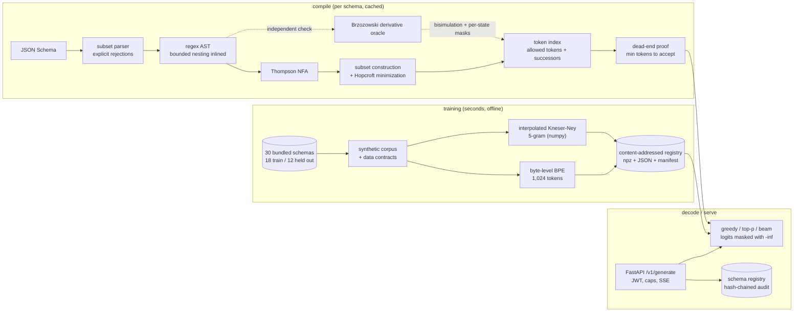

# grammar-constrained-decoder

**You hand it a data contract, and the language model becomes unable to break it.** The contract (a
JSON Schema) is compiled into a machine that knows, at every character, which continuations are
still legal. Everything else is removed from the model's choices before it picks.

Software that calls a language model usually needs structured data back: a record to insert, fields
to route on, a decision to act on. The normal approach is to write "answer in JSON" in the prompt,
parse the reply, and retry when parsing fails. That approach fails in expensive ways. The parse
throws at 3 a.m. and the batch job dies. Or it parses, a required field is missing, and a line item
quietly disappears from an invoice nobody re-reads. The retry loop is not free either: in this
repository's measurements, retrying cost 124.9 tokens per request against 31.0 for a single attempt
(four times the spend) and still produced zero valid documents.

This repository removes the failure mode instead of retrying it, and then proves the removal is
exact rather than asserting it. Everything runs offline on a CPU in seconds: no API key, no GPU, no
downloads.

## What this does

- **Turns a contract into a filter.** A JSON Schema (the document that says which fields must
  exist and what values they may hold) is compiled into an automaton: a lookup table of which next
  characters are still legal.
- **Filters the model's choices, every step.** At each step the model scores every token (a token
  is its unit of text, often a few characters). Illegal tokens are removed before the pick. 1,000
  of 1,000 generations came out valid, with no retries and no repair pass.
- **Proves the filter is exactly right, not roughly right.** A second checker, written from
  different mathematics, recomputes every allow/deny decision. Across 58.6 million decisions it
  found zero disagreements. A filter that is slightly too strict silently throws away good answers;
  that is the bug this catches.
- **Always finishes the document.** Generation cannot stop halfway through a half-written object.
  The filter also tracks how many tokens are left and only offers ones that can still reach a
  complete document in time.
- **Treats the contract itself as untrusted input.** A schema submitted by a caller can be built to
  make a naive compiler run forever. All 12 attack cases are refused with a named reason, worst case
  in 0.57 seconds.
- **Runs on a laptop.** The language model it steers is trained here, from scratch, in 2.8 seconds.

## Architecture



### How a request flows

1. **A client asks for a document.** It posts a prompt plus either an inline schema or the id of a
   schema registered earlier to `POST /v1/generate`, carrying a signed token.
2. **The service checks the caller,** not the content: token signature and scope, the caller's rate
   limit, a free concurrency slot, and caps on prompt length, `max_tokens` and schema size.
3. **The schema is read by this repository's own parser.** Anything outside the supported subset is
   refused with the offending keyword and a pointer to where it sits. Nothing is evaluated as code
   and no external reference is ever fetched.
4. **The schema becomes one pattern over bytes,** then an automaton: Thompson construction, subset
   construction, then minimization to the smallest equivalent machine. The whole compile runs under
   a budget of states, memory and wall-clock time, so a hostile schema hits a limit instead of the
   server's patience.
5. **Every token is walked through every state.** For each state of the automaton, each of the 1,024
   tokens in the vocabulary is traced byte by byte to record whether it fits and where it lands.
   This is the step that makes multi-character tokens such as `}}` correct. The table is cached in
   memory and on disk, keyed by schema and tokenizer.
6. **Generation starts.** At each step the language model returns a score for every token, the mask
   sets illegal ones to negative infinity, and the decoder samples or picks from what remains.
7. **The budget is enforced as it goes.** With `r` tokens left, only tokens that can still reach a
   finished document within `r - 1` more are offered, and end-of-text is allowed only when the
   document is already complete.
8. **The result is checked again by someone else's code** and returned, or streamed as
   Server-Sent Events with a final event carrying the validation result. An off-the-shelf
   `jsonschema` validator and this repository's automaton disagreed on 0 of the outputs the
   benchmarks compared.

Layout:

```text
src/grammar_constrained_decoder/
  automata/   charset, regex AST, pattern parser, NFA, DFA (Hopcroft), derivative oracle, limits
  schema/     subset parser (IR), numeric ranges, lowering, canonical serialization, sampler, validation
  lm/         byte-level BPE tokenizer, Kneser-Ney 5-gram
  decoding/   token index, compiler + cache, decoder, distortion study
  training/   corpus generation, pipeline (train, register, verified load)
  serving/    API, schema registry, concurrency caps, metrics, service
  core/ ml/   shared baseline: settings, logging, auth, rate limits, audit log, registry, drift
bench/        validity, exactness, distortion, performance, micro-benchmarks
tests/        unit + integration (property-based with hypothesis)
```

## Results

Every number here comes from a real run of a script in `bench/` on one machine: Windows 10
(10.0.19045), Intel64 Family 6 Model 158 (6 logical CPUs), Python 3.12.14, CPU only, no network.
Each script trains the corpus, tokenizer and 5-gram from scratch into a temporary directory first
(2.8 s) and fails with `--check` if a metric crosses `bench/thresholds.json`. CI runs all five (job
`bench`); locally `uv run python tasks.py bench` does the same. Recorded output is in
`bench/results/`, and every claim maps to a test or script in [CLAIMS.md](CLAIMS.md).

### The short version

| Measured | Result | Command | What it means for you |
|---|---|---|---|
| Valid output, constrained | **1,000 of 1,000 (100%)** | `uv run python bench/bench_validity.py --check` | Every single generation parsed and passed an independent JSON Schema validator. No retries, no repair step, no exceptions to handle. |
| Valid output, same model unconstrained | 0 of 1,000 (0%) | same | Prompting alone produced nothing usable from this model, and three retries did not help. |
| Mask exactness | **0 mismatches in 58,617,900 decisions** | `uv run python bench/bench_exactness.py --check` | A separately written checker recomputed every allow/deny decision and agreed every time. The filter is not just safe, it is not secretly over-strict. |
| Per-token overhead, p99 | 30.6 us | `uv run python bench/bench_performance.py --check` | The slowest 1 in 100 filtering steps still finished in 30.6 microseconds, about three hundredths of a millisecond. The median is 6.7 us. |
| Overhead against the model itself | 6.7 us vs 33.9 us per step | same | Filtering costs roughly a fifth of what one step of the language model costs, so the guarantee is close to free. |
| First compile of a new schema | 0.189 s median, 0.862 s worst | same | A schema's first use costs a fraction of a second. After that it is a cache hit: 0.363 ms from memory, 26.0 ms from disk. |
| Hostile schemas | 12 of 12 rejected, worst case 0.57 s | same | Attack schemas are refused with a named reason well inside the 2 s timeout, rather than tying up the server. |
| Distribution distortion | mean KL 2.07 nats over 20 schemas | `uv run python bench/bench_distortion.py --check` | Filtering is not a free lunch for quality: it measurably changes *which* valid document you get. Measured and reported here rather than left unmeasured. |

Read the 100% as a statement about construction, not luck, and read the 0% as a statement about the
bundled model as much as about masking. The shipped model is a deliberately weak 5-gram; see
[Non-goals](#non-goals) before treating the gap as the value masking would add to a capable model.

### Validity: constrained vs unconstrained vs 3 retries

`uv run python bench/bench_validity.py --check`: 1,000 nucleus-sampled generations (top-p 0.95,
temperature 1.0, `max_tokens` 256) on the 12 held-out schemas the model never saw. Valid means
`json.loads` succeeds and `jsonschema` (Draft 2020-12) accepts the value. Every output is also
checked with the service's `SafeValidator` (ECMA `pattern` semantics by DFA); the two validators
disagreed on 0 outputs. For unconstrained output, "parses" is the share that is JSON at all, and
"viable" is the mean share of an output's bytes before it leaves every valid document (the prefix
the grammar would still have accepted).

| held-out schema | n | constrained | unconstrained | + 3 retries | parses | viable | greedy c/u |
|---|---:|---:|---:|---:|---:|---:|---|
| invoice | 84 | 100.0% | 0.0% | 0.0% | 16.7% | 5.1% | ok/x |
| vital_signs | 84 | 100.0% | 0.0% | 0.0% | 11.9% | 5.3% | ok/x |
| shipment | 84 | 100.0% | 0.0% | 0.0% | 11.9% | 5.3% | ok/x |
| job_posting | 84 | 100.0% | 0.0% | 0.0% | 14.3% | 6.3% | ok/x |
| category_tree | 83 | 100.0% | 0.0% | 0.0% | 10.8% | 5.5% | ok/x |
| feature_flag | 83 | 100.0% | 0.0% | 0.0% | 13.2% | 6.8% | ok/x |
| game_score | 83 | 100.0% | 0.0% | 0.0% | 12.0% | 5.6% | ok/x |
| air_quality | 83 | 100.0% | 0.0% | 0.0% | 10.8% | 4.7% | ok/x |
| library_loan | 83 | 100.0% | 0.0% | 0.0% | 15.7% | 7.3% | ok/x |
| support_ticket | 83 | 100.0% | 0.0% | 0.0% | 9.6% | 7.1% | ok/x |
| hotel_booking | 83 | 100.0% | 0.0% | 0.0% | 9.6% | 5.4% | ok/x |
| geo_point | 83 | 100.0% | 0.0% | 0.0% | 20.5% | 4.4% | ok/x |

In plain terms: with the filter on, all 1,000 documents were usable. With it off, none were, and
the retry loop spent four times the tokens (124.9 against 31.0 per request) to achieve the same
nothing. 13.1% of the unconstrained outputs are JSON of some kind, but across all outputs only
0.15% of the target schema's required top-level keys are present: the objects it closes are built
out of *other* schemas' fields. On average only the first 5.7% of an output's bytes are still a
prefix of some valid document. The model also produced no valid document on the 18 schemas it was
trained on (0 of 360 samples), because with a four-token memory it forgets which schema it is
writing.

Because that baseline is so weak, the same script adds a stronger one: for each held-out schema, a
5-gram fitted on 120 sampled documents of that schema alone (same tokenizer and code, not the
shipped model), 20 samples per schema in the same three modes.

| held-out schema | n | constrained | unconstrained | + 3 retries | parses | viable |
|---|---:|---:|---:|---:|---:|---:|
| invoice | 20 | 100.0% | 0.0% | 0.0% | 5.0% | 23.7% |
| vital_signs | 20 | 100.0% | 5.0% | 30.0% | 50.0% | 36.0% |
| shipment | 20 | 100.0% | 0.0% | 0.0% | 35.0% | 17.9% |
| job_posting | 20 | 100.0% | 0.0% | 5.0% | 0.0% | 42.4% |
| category_tree | 20 | 100.0% | 15.0% | 50.0% | 25.0% | 60.8% |
| feature_flag | 20 | 100.0% | 0.0% | 10.0% | 25.0% | 29.3% |
| game_score | 20 | 100.0% | 0.0% | 0.0% | 0.0% | 47.8% |
| air_quality | 20 | 100.0% | 40.0% | 90.0% | 60.0% | 65.9% |
| library_loan | 20 | 100.0% | 0.0% | 0.0% | 60.0% | 20.5% |
| support_ticket | 20 | 100.0% | 0.0% | 0.0% | 0.0% | 25.8% |
| hotel_booking | 20 | 100.0% | 10.0% | 15.0% | 30.0% | 13.2% |
| geo_point | 20 | 100.0% | 0.0% | 15.0% | 15.0% | 33.2% |

The specialist model knows the target format and does better, but not well: 5.8% of its
unconstrained samples are valid, 17.9% after up to three retries (231.2 tokens per request on
average), 25.4% parse as JSON, and on average a third of each output is a viable prefix.
High-entropy values (random identifiers, long digit strings) push a four-token context off the
document structure. With the mask, both models are valid in 100% of samples.

<details>
<summary>Recorded metrics (bench/results/validity.json)</summary>

```text
generations: 1000.0
constrained_valid_ratio: 1.0
unconstrained_valid_ratio: 0.0
unconstrained_3_retries_valid_ratio: 0.0
unconstrained_json_parse_ratio: 0.131
unconstrained_required_keys_ratio: 0.0015
unconstrained_viable_prefix_ratio: 0.0573
constrained_tokens_per_generation: 57.3
unconstrained_tokens_per_generation: 31.0
retry_tokens_per_generation: 124.9
greedy_constrained_valid_schemas: 12.0
greedy_unconstrained_valid_schemas: 0.0
seen_schema_unconstrained_valid_ratio: 0.0
constrained_validator_disagreements: 0.0
validator_disagreements: 0.0
single_schema_generations: 240.0
single_schema_constrained_valid_ratio: 1.0
single_schema_unconstrained_valid_ratio: 0.0583
single_schema_3_retries_valid_ratio: 0.1792
single_schema_unconstrained_json_parse_ratio: 0.2542
single_schema_unconstrained_required_keys_ratio: 0.2094
single_schema_unconstrained_viable_prefix_ratio: 0.3471
single_schema_retry_tokens_per_generation: 231.2
held_out_seconds: 39.5
single_schema_seconds: 12.9
```

</details>

### Exactness: is the filter actually right?

This is the claim the project exists to defend. A filter that is too permissive lets invalid output
through; one that is too strict silently deletes good answers and skews the model further. Testing
the automaton against itself proves nothing, so a second implementation, built on Brzozowski
derivatives (a different way to define the same language), recomputes everything independently.

`uv run python bench/bench_exactness.py --check` runs it over 2,000 derandomized
`hypothesis`-generated schemas with the real 1,024-token vocabulary, then over all 30 bundled and 20
tiny schemas:

| Check | Scale | Mismatches |
|---|---|---:|
| DFA equivalent to the schema pattern (bisimulation) | 62,288 state/derivative pairs | **0** |
| Allowed tokens and successors per state, generated schemas | 57,300 states, 58,617,900 decisions | **0** |
| Same check on bundled and tiny schemas | 33,424 states, 34,192,752 decisions | **0** |
| Completeness: real instances are accepted | 5,331 `hypothesis-jsonschema` instances | **0** failures |
| No dead ends: every state can still finish | 50 schemas | **0** failures |
| Pattern engine vs Python `re` on trusted patterns | 40,000 comparisons | **0** disagreements |

Notes an engineer will want. Of the 2,000 generated schemas, 5 describe an empty language and are
rejected at compile time with `empty_language`; no generated schema is rejected for any other
reason, and the other 1,995 are checked. The oracle finds the token-reachable states itself rather
than trusting the index's list, so a broken index cannot hide a state from the check. The bundled
and tiny schemas cover patterns and recursion up to 3,139 DFA states. The `re` comparison uses 500
generated patterns times 40 strings, on an alphabet where ECMA and Python agree (unanchored bodies,
`re.ASCII` classes, no Unicode digits, no Unicode spaces, no `\n`); the dialect differences are
listed in [SCHEMA_SUPPORT.md](SCHEMA_SUPPORT.md).

<details>
<summary>Recorded metrics (bench/results/exactness.json)</summary>

```text
schemas: 1995.0
rejected_empty_language: 5.0
unexpected_rejections: 0.0
dfa_states: 59295.0
token_reachable_states: 57300.0
token_decisions: 58617900.0
allowed_tokens: 2003247.0
equivalence_pairs: 62288.0
mask_mismatches: 0.0
equivalence_mismatches: 0.0
instances: 5331.0
completeness_failures: 0.0
instance_generation_skipped: 0.0
exactness_seconds: 99.7
dead_end_schemas_checked: 50.0
dead_end_failures: 0.0
corpus_oracle_schemas: 50.0
corpus_dfa_states: 33474.0
corpus_token_reachable_states: 33424.0
corpus_token_decisions: 34192752.0
corpus_equivalence_mismatches: 0.0
corpus_mask_mismatches: 0.0
corpus_seconds: 48.6
re_comparisons: 40000.0
re_disagreements: 0.0
mean_dfa_states: 29.7
total_seconds: 155.2
```

</details>

### The cost: masking changes the model's preferences

Guaranteeing validity is not the same as guaranteeing the *best* valid answer. Removing tokens and
renormalizing what is left, step by step, is not equivalent to picking the model's most likely valid
document. Most write-ups of constrained decoding skip this. This one measures it.

`uv run python bench/bench_distortion.py --check`: 20 tiny schemas whose token languages are small
enough to enumerate exactly. `P(. | valid)` is the model conditioned on validity (what an ideal
constrained sampler would draw from), `Q` is the distribution masked, locally renormalized sampling
actually draws from. KL is KL(P(. | valid) || Q) in nats, a standard measure of how far one
distribution is from another; 0 means identical. "TV samples" compares 300 real decoder samples with
the exact `Q`. Enumeration and sampling use a 32-token budget; the longest valid string among the 20
schemas is 20 bytes (`{"a":false,"b":null}`), so the budget excludes no tokenization.

| schema | strings | token seqs | valid mass | KL string | KL token | greedy = mode | TV samples |
|---|---:|---:|---:|---:|---:|---|---:|
| bool | 2 | 12 | 4.52e-09 | 0.1798 | 2.7150 | no | 0.038 |
| null | 1 | 5 | 2.26e-09 | 0.0000 | 2.2663 | yes | 0.000 |
| color | 3 | 10 | 1.92e-19 | 1.4518 | 2.4557 | no | 0.047 |
| answer | 3 | 7 | 2.61e-17 | 0.9876 | 3.1228 | no | 0.025 |
| digit | 10 | 10 | 3.84e-07 | 0.0016 | 0.0016 | yes | 0.111 |
| percent | 100 | 152 | 1.95e-06 | 1.1777 | 1.2426 | no | 0.227 |
| offset | 11 | 11 | 2.38e-07 | 0.1166 | 0.1166 | yes | 0.049 |
| ab_word | 7 | 7 | 2.43e-13 | 4.0235 | 4.0235 | no | 0.034 |
| abc_code | 12 | 12 | 1.52e-15 | 6.3915 | 6.3915 | no | 0.068 |
| ok_flag | 2 | 48 | 6.74e-12 | 0.0013 | 0.0956 | yes | 0.033 |
| small_id | 5 | 40 | 1.11e-04 | 0.0109 | 0.0203 | yes | 0.057 |
| bool_pair | 7 | 157 | 2.99e-13 | 3.7686 | 3.7692 | no | 0.048 |
| bits | 14 | 14 | 9.78e-16 | 5.3332 | 5.3332 | no | 0.050 |
| maybe_bool | 3 | 17 | 6.78e-09 | 0.1410 | 2.5866 | no | 0.019 |
| optional_pair | 6 | 1029 | 6.28e-08 | 5.6833 | 5.7073 | no | 0.014 |
| priority | 3 | 16 | 2.91e-17 | 0.5984 | 2.6192 | no | 0.022 |
| digit_string | 11 | 11 | 2.46e-13 | 5.9507 | 5.9507 | no | 0.070 |
| log_level | 2 | 768 | 2.97e-06 | 0.0750 | 0.1006 | no | 0.000 |
| small_ints | 21 | 21 | 3.01e-13 | 5.5228 | 5.5228 | no | 0.074 |
| teen | 11 | 22 | 3.71e-07 | 0.0328 | 0.2642 | yes | 0.064 |

What the numbers say. The mean string-level KL is 2.07 nats (median 0.79, max 6.39), so masking is
not a neutral operation. Greedy constrained decoding returned the most likely valid string, under
the model conditioned on validity, for only 6 of the 20 schemas. Six of the seven schemas with a
KL above 3.7 nats give less than 1e-12 of the unconstrained model's mass to valid output: when the
model rarely wants to go where the grammar allows, the mask forces it through continuations it
considers unlikely, and local renormalization skews hardest. Low valid mass alone does not predict
it, though (`color`, at 1.9e-19, has a KL of 1.45). The TV column is a check of the decoder against
the exact `Q`, with 300 draws and up to 100 strings, not a distortion measure.

Practical reading: if you need a guarantee that the output fits the contract, this gives it. If you
need the model's *best* answer and the model is reluctant to satisfy the contract at all, expect the
filter to change the answer, and prefer a model that wants to comply.

<details>
<summary>Recorded metrics (bench/results/distortion.json)</summary>

```text
schemas: 20.0
kl_string_mean: 2.0724
kl_string_median: 0.793
kl_string_max: 6.3915
kl_token_mean: 2.7153
greedy_is_mode_ratio: 0.3
sampled_tv_max: 0.227
kl_string_exceeds_kl_token: 0.0
```

</details>

### Speed, compile time and hostile schemas

`uv run python bench/bench_performance.py --check` measures mask overhead across constrained greedy
and top-p decoding of every held-out schema, cold compiles of all 30 bundled schemas, and 12 stress
cases against a 2 s compile timeout.

| Metric | Value | Reading |
|---|---:|---|
| mask overhead p50 | 6.7 us | Typical cost of fetching the budget-aware mask and applying it to the logits. |
| mask overhead p95 | 19.3 us | 95 of 100 steps cost at most this. |
| mask overhead p99 | 30.6 us | The slowest 1 in 100 steps still finished in 30.6 microseconds. |
| one LM step p50 | 33.9 us | For scale: the numpy 5-gram itself costs five times the median mask. No neural model is measured here. |
| cold compile, median | 0.189 s | Parse, lower, NFA, DFA, minimize, token index and dead-end proof for a fresh schema. |
| cold compile, max | 0.862 s | Worst of the 30 bundled schemas. |
| cache hit, memory | 0.363 ms | Second request for the same schema in the same process. |
| cache hit, disk | 26.0 ms | Second request after a restart. |
| stress cases accepted | 0 of 12 | Every attack schema was refused. |
| worst stress case | 0.57 s | Well inside the 2 s timeout. |

Compile cost tracks DFA states times vocabulary size (the index walk), not schema bytes. A recursive
199-byte `category_tree` costs almost as much as a 599-byte `invoice`:

| schema | canonical bytes | DFA states | index entries | cold compile (s) |
|---|---:|---:|---:|---:|
| category_tree | 199 | 2532 | 216718 | 0.645 |
| feature_flag | 330 | 147 | 15619 | 0.031 |
| library_loan | 342 | 85 | 1201 | 0.014 |
| user_profile | 370 | 645 | 108685 | 0.212 |
| calendar_event | 491 | 3139 | 335346 | 0.803 |
| invoice | 599 | 2645 | 315949 | 0.862 |
| order | 726 | 842 | 111328 | 0.259 |

Each stress case is a schema designed to make a compiler misbehave. Each is rejected with a typed
reason, not a hang and not a 500:

| stress case | rejection reason | seconds |
|---|---|---:|
| deep_nesting_200 | schema_depth | 0.0 |
| enum_10000 | enum_size | 0.011 |
| pattern_5000_chars | pattern_length | 0.0 |
| exponential_dfa | dfa_states | 0.168 |
| nested_counters | subset_size | 0.57 |
| max_length_1e9 | repeat_bound | 0.0 |
| bound_1e40 | number_digits | 0.0 |
| object_500_properties | properties | 0.001 |
| any_of_5000 | schema_size | 0.023 |
| backreference | pattern | 0.001 |
| ref_chain_600 | ref_depth | 0.006 |
| lone_surrogate_enum | invalid | 0.0 |

`nested_counters` is the interesting one. It used to run until the deadline, allocating subsets the
whole way, and was only stopped by the timeout. Subset construction is now charged for the
NFA-state entries it holds, so the pattern hits the 1,000,000-entry cap and stops in 0.57 s. The
deadline itself is cooperative: it is checked at every new DFA state and every few dozen cheaper
steps, so a compile that does reach it stops within one check interval
(`tests/unit/test_compiler.py::test_timeouts_fire_within_one_check_interval` lifts every other cap
and asserts at most 0.25 s past a 0.5 s deadline).

Micro-benchmarks, `uv run python bench/bench_baseline.py --check` (p95): cached mask fetch and apply
3.7 us, one LM step 57.9 us, compile from the memory cache 358 us, cold compile of `invoice` 0.93 s,
DFA match of a 10 KB ReDoS-style input 3.3 ms (linear, no backtracking).

<details>
<summary>Recorded metrics (bench/results/performance.json)</summary>

```text
mask_tokens_measured: 6984.0
mask_p50_us: 6.7
mask_p95_us: 19.3
mask_p99_us: 30.6
lm_step_p50_us: 33.9
compile_cold_median_s: 0.189
compile_cold_max_s: 0.862
compile_memory_hit_ms: 0.363
compile_disk_hit_ms: 26.0
stress_cases: 12.0
stress_accepted: 0.0
stress_max_seconds: 0.57
```

</details>

## How it works

The short answer for engineers: because nesting depth is bounded, the language of a schema is
regular, so it can be a minimized DFA instead of a parser, and a DFA can be indexed against the
vocabulary once and reused.

**Compiler.** `schema/ir.py` parses the supported subset (see
[SCHEMA_SUPPORT.md](SCHEMA_SUPPORT.md)) and rejects everything else with a JSON Pointer and a
reason. `schema/lower.py` produces one byte-level regex for compact canonical JSON: members in
declaration order, canonical string escapes, integer and decimal ranges lowered to digit-level
languages (`schema/numeric.py`), string lengths counted in code points, patterns from the in-repo
ECMA subset parser (`automata/pattern.py`) translated into the JSON-escaped encoding and intersected
with the length language. Nesting is bounded (default depth 6) and recursive `$ref`s are unrolled to
that depth. `automata/nfa.py` and `automata/dfa.py` implement Thompson's construction, subset
construction over byte equivalence classes, product automata for intersection, and Hopcroft
minimization with a canonical renumbering, all charged to a budget of NFA states, DFA states and
wall-clock time.

**Token index.** For every live DFA state, every token's bytes are walked through the transition
table (vectorized with numpy), recording allowed tokens and successor states. A reverse
breadth-first search gives the fewest tokens from each state to acceptance; the compiler refuses a
grammar if any state reachable at a token boundary cannot finish. Compiled grammars are cached in
memory and on disk (npz, keyed by schema hash, tokenizer hash and limits).

**Decoder.** Greedy, nucleus (top-p) and beam search over the model's log-probabilities, with
disallowed tokens set to `-inf`. EOS is allowed only in accepting states, and with `r` tokens left
only tokens that can still reach acceptance in `r - 1` more are offered, so every generation ends in
a valid document within `max_tokens`.

**Oracle.** `automata/oracle.py` rebuilds the language with Brzozowski derivatives, independently of
the NFA/DFA code, walks the product of DFA states and derivatives (a bisimulation, so a clean walk
proves the DFA exact) and recomputes every mask and successor of the token index.

**Model.** An interpolated modified Kneser-Ney 5-gram over BPE token ids, trained in numpy on a
synthetic corpus of 2,160 prompted JSON documents plus 600 template sentences
([MODEL_CARD.md](MODEL_CARD.md)). It is weak on purpose: claims here concern validity, exactness,
overhead and distortion, not semantic quality.

**Service.** `POST /v1/generate` (JSON or Server-Sent Events) with a registered `schema_id` or an
inline `schema`; `POST /v1/schemas` (admin scope, audited); `GET /v1/schemas[/{id}]`; `/healthz`,
`/readyz` (model loaded and hash-verified, registry audit chain valid) and `/metrics`
(`tokens_per_second`, `mask_latency_seconds`, `index_cache_hit_ratio`, `compile_seconds`,
`compile_rejections_total`, `output_validity_ratio`, `prompt_length_psi`).

### The central trade-off, and why not the obvious alternative

The obvious approach is to accept any JSON Schema and run an incremental parser (a pushdown
automaton, Earley, LR) at decoding time, simulating it on each candidate token. That is what most
general-purpose constrained decoders do, and it handles unbounded recursion.

This repository takes the other side of the trade: **cap nesting depth, and the language becomes
regular.** What that buys is worth the cost:

| | Incremental parser | Bounded depth plus DFA (this repo) |
|---|---|---|
| Schema coverage | Any schema, unbounded recursion | A documented subset, depth capped at 6 by default |
| Per-token cost | Simulate the parser per candidate token | One array lookup; p50 6.7 us |
| Provable exactness | Hard: no independent model of the same language | A derivative oracle proves it; 0 mismatches in 58.6 M decisions |
| Termination | Needs separate reasoning | A reverse BFS proves no state is a dead end, at compile time |
| Worst-case compile | Usually cheap | Can explode, so every stage is budgeted and capped |

The cost is real and it is the subset: `oneOf`, `not`, conditionals and open objects are refused
rather than half-supported. The gain is that "the mask is exact" stops being a claim and becomes a
checked property, and that per-token cost drops to an array lookup.

The reasoning behind each decision is recorded:

- [ADR 0002 - bounded nesting as one regular language](docs/adr/0002-bounded-nesting-as-a-regular-language.md)
- [ADR 0003 - a precomputed token index over the minimal DFA](docs/adr/0003-precomputed-token-index-over-the-minimal-dfa.md)
- [ADR 0004 - an independent derivative oracle](docs/adr/0004-independent-derivative-oracle.md)
- [ADR 0005 - a Kneser-Ney n-gram instead of a neural model](docs/adr/0005-kneser-ney-n-gram-model.md)
- [ADR 0006 - canonical output and budget-aware masks](docs/adr/0006-canonical-output-and-budget-aware-masks.md)

## Security

The one thing to understand first: **valid is not the same as safe.** The decoder guarantees that
output parses and matches the schema. It does not make the content true, authorized or harmless. A
perfectly valid `{"action": "delete", "id": 7}` is still just text from a model, and a prompt can
steer which valid document comes out. Authorize every effect of the output downstream, exactly as
you would for any other untrusted input.

The second thing: **a schema is untrusted input too.** Callers can submit schemas inline, and
compiling one is real work, so a hostile schema is a denial-of-service tool. Every client schema is
vetted before a single token is generated, whether or not decoding is constrained.

Threats, controls and the test that proves each one are in
[docs/THREAT_MODEL.md](docs/THREAT_MODEL.md) (STRIDE per trust boundary); every claim below links to
evidence in [CLAIMS.md](CLAIMS.md).

| Concern in plain terms | Mechanism |
|---|---|
| A submitted schema hangs or crashes the server | Parsed only by the in-repo parser (no eval, local `$ref` only, unsupported keywords rejected by name). Caps on depth, schema size, properties, enum size, literal and pattern length, repetition counts, number digits, `$ref` expansion depth, NFA states, DFA states, subset-construction memory and token-index entries, plus a cooperative wall-clock timeout checked at every new DFA state. Every rejection is a typed `400`/`413` with a reason and a metric; rejected schemas are remembered by digest for five minutes so a replay is not recompiled. |
| A regular expression in a schema causes catastrophic backtracking | Patterns are matched by DFA in linear time. Output validation swaps `jsonschema`'s `pattern` implementation for the DFA, so Python's `re` never compiles a client pattern. A 10 KB ReDoS-style input matches in 3.3 ms. |
| A schema reference makes the server fetch a URL or read a local file | Validators are built with a reference registry that never retrieves. No `http://` or `file://` reference is ever fetched or read, and non-local `$ref` is rejected up front. |
| Anyone can generate, or quietly change the schemas | HS256 JWTs (pinned algorithm, required claims, bounded lifetime, fail closed without a secret) with a `generate` scope for decoding and `schemas:admin` for registration. `/metrics` needs an operator API key. Per-subject rate limits, non-blocking global and per-client concurrency caps, and caps on `max_tokens`, prompt length and inline schema size. |
| Someone edits a stored schema or the model on disk after the fact | Registrations and every rejected attempt are appended to a hash-chained audit log. A stored schema that no longer matches its audited hash is refused and fails `/readyz`. Model counts and tokenizer load from npz (`allow_pickle=False`) and JSON only after the registry and run manifest hashes verify. |
| Prompts or outputs leak into logs | Never logged. Log lines carry lengths, truncated SHA-256 digests, the schema label, token counts and timings. |
| One slow request stalls every other request | Compilation, decoding steps and output validation all run in worker threads, streamed or not, so the event loop stays free. |

CI runs ruff, mypy --strict, pytest with an 85% coverage floor, bandit, semgrep with repo rules,
pip-audit, gitleaks, hadolint, trivy and a syft CycloneDX SBOM, with base images pinned by digest.
See [SECURITY.md](SECURITY.md) for reporting.

Containers: `docker compose up --build` builds a non-root, read-only image that trains the model at
build time and stores registry state in a named volume. Container build, smoke test (health and
readiness), trivy scan and SBOM run in CI (`.github/workflows/ci.yml`, job `docker`). The build, the
non-root check (`uid=10001(app)`), the HEALTHCHECK, `/readyz` and one authenticated `/v1/generate`
call were also verified locally with Docker 29.6.1; the CVE scan and SBOM run in CI only.

## Quickstart

Requirements: [uv](https://docs.astral.sh/uv/) and Python 3.12. No GPU, no API key, no network
after `uv sync`.

```bash
uv sync --frozen
uv run python tasks.py demo
```

What you will see: the corpus, tokenizer and 5-gram train from scratch in about three seconds; three
schemas are compiled and printed with their automaton sizes; each is generated twice, once with the
mask and once without, so the valid document and the malformed one sit side by side; the same request
streams over Server-Sent Events; the audit chain is verified; and the distortion statistics print at
the end.

Two more commands worth running:

```bash
uv run python tasks.py bench    # every bench/ script against bench/thresholds.json
uv run python tasks.py check    # ruff, mypy --strict, pytest + coverage, bandit, pip-audit, baseline
```

On Windows with a small repository drive, keep the environment elsewhere first:
`$env:UV_PROJECT_ENVIRONMENT = "C:/Users/<you>/.venvs/grammar-constrained-decoder"`.

Run the service yourself:

```bash
uv run grammar-constrained-decoder train --workdir var/model          # ~3 s, writes var/model/registry
export APP_JWT_SECRET="$(python -c 'import secrets; print(secrets.token_urlsafe(48))')"
TOKEN="$(uv run grammar-constrained-decoder issue-token --sub alice --scope generate)"
uv run grammar-constrained-decoder serve &
curl -s -H "Authorization: Bearer $TOKEN" -H "Content-Type: application/json" \
     -d '{"prompt": "Q: a geographic point\ngeo_point:\n", "schema_id": "geo_point", "max_tokens": 64}' \
     http://127.0.0.1:8000/v1/generate
curl -sN -H "Authorization: Bearer $TOKEN" -H "Content-Type: application/json" \
     -d '{"schema": {"type": "object", "properties": {"ok": {"type": "boolean"}}, "required": ["ok"]}, "stream": true}' \
     http://127.0.0.1:8000/v1/generate
```

To inspect a schema without generating anything, compile it and print its automaton statistics:
`uv run grammar-constrained-decoder compile my_schema.json`.

## Non-goals

What this is not, stated plainly so nobody is surprised later.

- **Not full JSON Schema.** `oneOf`, `allOf`, `not`, conditionals, `format`, `multipleOf`,
  `patternProperties`, open objects, `uniqueItems: true`, `prefixItems`/`contains`, remote refs and
  unbounded recursion are rejected ([SCHEMA_SUPPORT.md](SCHEMA_SUPPORT.md)). Several are regular in
  principle (`oneOf` via language difference) but would need complement automata and are cut.
- **Not arbitrary JSON formatting.** Output is compact canonical JSON in declaration order. Pretty
  printing, reordered members and exponent notation are never generated.
- **Not a claim about semantic quality.** The 5-gram model forgets which schema it is writing after
  four tokens, so constrained output is valid but often semantically odd (a timestamp in a name
  field). No claim is made about content quality, and no neural model is included.
- **Not a strong unconstrained baseline.** The strongest baseline here, a 5-gram trained on each
  held-out schema alone, is valid in only a few percent of unconstrained samples. A baseline that is
  right 30-70% of the time would need a model with longer memory than an n-gram, which is out of
  scope (no neural models, no downloads). The validity comparison therefore shows what masking
  guarantees, not how much it adds to a capable model.
- **Not Python `re` pattern semantics.** `pattern` follows ECMA-262 as JSON Schema requires. Where
  Python's `re` differs (Unicode `\d`/`\w`, `$` before a final newline, see
  [SCHEMA_SUPPORT.md](SCHEMA_SUPPORT.md)), a document can pass one validator and fail the other.
- **Not distortion-free.** The distortion of locally renormalized masking is measured, not
  corrected; grammar-aligned sampling (for example importance weighting or ASAp) is future work.
- **Not distributed serving.** Rate limits, concurrency caps and caches are per process. There is no
  batching across requests and no GPU path.
- **Not signed artifacts.** The model registry, index cache and schema registry are hash-verified,
  not signed. An attacker who can rewrite a manifest or recompute a cache checksum is out of scope
  (threat model T3, T4).
- **No token revocation.** JWTs are verified statelessly; there is no revocation list and no key
  rotation.

## References

- K. Thompson, "Regular expression search algorithm", CACM 1968 (NFA construction).
- M. O. Rabin and D. Scott, "Finite automata and their decision problems", 1959 (subset construction).
- J. Hopcroft, "An n log n algorithm for minimizing states in a finite automaton", 1971.
- J. A. Brzozowski, "Derivatives of regular expressions", JACM 1964; S. Owens, J. Reppy and
  A. Turon, "Regular-expression derivatives re-examined", JFP 2009.
- R. Kneser and H. Ney, "Improved backing-off for m-gram language modeling", ICASSP 1995;
  S. F. Chen and J. Goodman, "An empirical study of smoothing techniques for language modeling", 1998.
- B. T. Willard and R. Louf, "Efficient Guided Generation for Large Language Models", 2023
  (FSM-indexed vocabulary masks, the idea implemented here from scratch).
- K. Park et al., "Grammar-Aligned Decoding", NeurIPS 2024 (distortion of constrained sampling).
- The UTF-8 range splitting follows the construction used by RE2 and Rust's `regex-syntax`.
