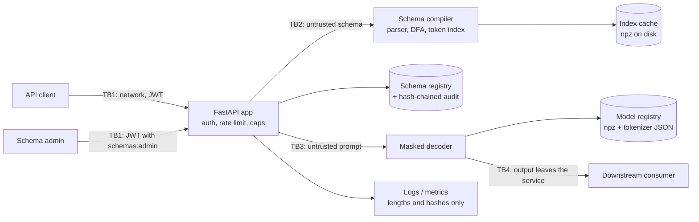

# Threat model

Method: STRIDE per trust boundary. Each row maps a threat to the control that addresses it and to
the test, bench script or CI job that proves the control works. `scripts/check_baseline.py`
verifies that every backticked evidence reference exists.

## System and trust boundaries

Assets: availability of the decoding service (CPU is the scarce resource), integrity of the
schema registry and of model artifacts, the guarantee that constrained output is schema-valid,
confidentiality of prompts and outputs, JWT and API-key secrets.

Assumptions: TLS terminates in front of the service; the host and container runtime are trusted;
the JWT secret is distributed out of band; the model directory is baked into the image read-only
and the data directory (registry, audit log, index cache) is writable only by the service user.

**Validity is not safety.** The decoder guarantees that output parses and validates against the
schema. It does not make the content true, authorized or harmless: a valid
`{"action": "delete", "id": 7}` is still just text from a model. Consumers must authorize every
effect of the output exactly as they would for any other untrusted input (row E3).

## STRIDE table

| ID | STRIDE | Threat | Entry point / asset | Control | Test / evidence | Residual risk |
|---|---|---|---|---|---|---|
| S1 | Spoofing | Forged, expired, unsigned or algorithm-confused JWT gets access | TB1, `/v1/*` | PyJWT pinned to HS256; required `exp`, `iat`, `sub`, `iss`, `aud`; lifetime cap; fail closed without a secret; 32-byte minimum secret | `tests/unit/test_jwt_limits_metrics.py::test_invalid_claims_are_rejected`, `tests/unit/test_jwt_limits_metrics.py::test_algorithm_confusion_and_unsigned_tokens_are_rejected`, `tests/unit/test_jwt_limits_metrics.py::test_no_secret_fails_closed`, `tests/unit/test_config.py::test_short_jwt_secrets_are_rejected` | Symmetric secret: anyone holding it can mint tokens; no revocation list |
| S2 | Spoofing | A generate-only client registers or replaces schemas | TB1, `POST /v1/schemas` | `schemas:admin` scope required; builtin ids reserved; registrations immutable (409 on different content) | `tests/integration/test_serving_api.py::test_schema_registration_needs_admin_and_is_audited` | Admin tokens are bearer credentials; protect them like the secret |
| S3 | Spoofing | Operator API key guessed for `/metrics` | TB1 | SHA-256 digests, constant-time compare against every digest, fail closed | `tests/unit/test_security.py::test_every_configured_digest_is_compared_without_early_exit`, `tests/unit/test_security.py::test_no_configured_keys_fails_closed` | No key rotation workflow |
| T1 | Tampering | Stored schema edited on disk to loosen the contract after registration | Schema registry | Each file must match the SHA-256 recorded by its audited registration; a mismatch is refused (500) and fails `/readyz` | `tests/integration/test_serving_api.py::test_a_schema_edited_on_disk_is_refused` | An attacker who can rewrite both the file and the whole audit chain is not detected; anchor the audit head elsewhere |
| T2 | Tampering | Audit trail of registrations edited, reordered or truncated | `registry_audit.jsonl` | Hash chain over canonical JSON; verify CLI; head anchoring; writer refuses a shrunk or rewritten log | `tests/unit/test_core_audit.py::test_any_single_byte_change_is_detected`, `tests/unit/test_core_audit.py::test_tail_truncation_needs_an_anchored_head`, `tests/unit/test_core_audit.py::test_truncation_while_open_is_detected_on_the_next_append` | Tail truncation after the fact needs an externally stored head |
| T3 | Tampering | Model counts or tokenizer swapped, or an npz with pickled objects planted | Model registry | Content-addressed registry verifies record and blob hashes; the manifest binds `counts_sha256`, `tokenizer_sha256` and `vocab_sha256`; npz loaded with `allow_pickle=False`; arrays structurally validated; the service stays unready on failure | `tests/integration/test_pipeline.py::test_tampered_tokenizer_blob_is_refused`, `tests/integration/test_pipeline.py::test_a_consistently_rehashed_but_foreign_tokenizer_is_refused`, `tests/integration/test_pipeline.py::test_pickled_arrays_are_refused_even_with_matching_hashes`, `tests/integration/test_serving_api.py::test_missing_or_tampered_model_leaves_the_service_unready` | Registry records are not signed: someone who can rewrite the manifest too can register a different model |
| T4 | Tampering | Corrupted or planted token-index cache entry weakens masks | Index cache (`.npz`) | Key includes compiler version, schema hash, vocabulary hash and limits; checksum over arrays; header key check; structural validation; any failure is a miss and a recompile | `tests/unit/test_compiler.py::test_corrupted_or_foreign_cache_entries_are_recompiled` | The checksum is not a MAC: a writer who recomputes it can plant an index; keep the cache directory service-writable only |
| T5 | Tampering | Masks that are subtly wrong let invalid output through or forbid valid output | Compiler, token index | Independent derivative oracle proves DFA equivalence and recomputes every mask; 2,000-schema exactness bench with zero mismatches enforced in CI; brute-force index test | `tests/unit/test_oracle.py::test_token_index_check_passes_and_catches_corruption`, `tests/unit/test_index.py::test_index_equals_a_brute_force_walk_of_every_token`, `bench/bench_exactness.py`, `.github/workflows/ci.yml#bench` | The oracle checks the automaton pipeline, not the schema lowering; lowering is covered by soundness and completeness tests |
| T6 | Tampering | Dependency, base image or CI action compromised | Build pipeline | uv.lock with hashes; pip-audit; digest-pinned base images; trivy; CycloneDX SBOM; Dependabot | `.github/workflows/ci.yml#pip-audit`, `.github/workflows/ci.yml#docker` | Actions are tag-pinned until SHA pinning at publish time |
| R1 | Repudiation | Admin denies registering or attempting to register a schema | Schema registry | Every registration and every rejected registration is audited with the JWT subject, schema id and SHA-256 | `tests/integration/test_serving_api.py::test_schema_registration_needs_admin_and_is_audited` | Timestamps come from the host clock |
| I1 | Information disclosure | Prompts or outputs leak into logs | Logs | The service logs lengths, truncated SHA-256 digests, schema label, token counts and timings, never text; structlog redaction runs on everything else | `tests/integration/test_serving_api.py::test_prompts_and_outputs_never_reach_the_logs`, `tests/unit/test_logging.py::test_exception_tracebacks_are_redacted` | Digests of short, guessable prompts can be brute-forced; they are truncated to 64 bits |
| I2 | Information disclosure | Error bodies echo schema contents, prompts or internals | TB1 | Fixed error codes; compile errors name the keyword and a sanitized, truncated JSON Pointer; validation details never include values; generic 500 | `tests/unit/test_schema_ir.py::test_unknown_keywords_are_rejected_with_a_sanitized_name`, `tests/integration/test_app.py::test_validation_errors_never_echo_submitted_values`, `tests/integration/test_app.py::test_unhandled_exceptions_become_generic_500s` | Property names up to 40 printable ASCII characters can appear in compile errors |
| I3 | Information disclosure | Corpus contract failures copy synthetic values into errors | Training pipeline | Contract errors report check names and counts only | `tests/unit/test_corpus_contracts.py::test_violations_are_summarized_without_the_offending_values` | None known |
| D1 | Denial of service | Hostile schema causes state explosion (DFA blow-up, nested counters, huge enums, deep nesting) | TB2, compiler | Parse-time caps (depth, nodes, properties, enum size, literal bytes, pattern length, repetition counts, number digits); NFA, DFA and index-entry caps; cooperative wall-clock timeout checked inside every construction loop; typed rejection reasons and a metric | `tests/integration/test_stress.py::test_adversarial_schemas_are_rejected_cleanly_within_the_timeout`, `tests/unit/test_compiler.py::test_state_explosions_are_rejected_within_the_timeout`, `bench/bench_performance.py` | A schema just under every cap still costs up to the timeout; the compile runs in a worker thread while the request holds a concurrency slot |
| D2 | Denial of service | ReDoS through a schema `pattern` | TB2, validation | Patterns are parsed by the in-repo parser and matched by DFA in linear time; output validation replaces jsonschema's `pattern` with the DFA, so Python `re` never sees a client pattern | `tests/unit/test_dfa.py::test_matching_is_linear_on_classic_redos_patterns`, `tests/unit/test_pattern.py::test_python_re_is_never_used_to_compile_patterns`, `tests/integration/test_serving_api.py::test_python_re_never_sees_a_client_pattern` | None known |
| D3 | Denial of service | Long generations or many parallel generations exhaust CPU | TB1, TB3 | `max_tokens` cap; prompt character and token caps; inline schema byte cap; per-client token-bucket rate limit keyed by JWT subject; non-blocking global and per-client concurrency caps (429); leases released on stream disconnect | `tests/integration/test_serving_api.py::test_request_caps`, `tests/integration/test_serving_api.py::test_prompt_token_cap`, `tests/integration/test_serving_api.py::test_concurrency_cap_returns_429`, `tests/integration/test_serving_api.py::test_rate_limit_is_per_authenticated_subject` | Limits are per process; a multi-replica deployment needs a shared limiter |
| D4 | Denial of service | Generation never terminates or ends truncated (valid prefix, invalid document) | Decoder | Budget-aware masks only allow tokens that can still reach acceptance in the remaining budget; EOS only in accepting states; requests below the schema's minimum token count are refused up front | `tests/unit/test_decoder.py::test_the_tightest_budget_still_finishes_validly`, `tests/unit/test_index.py::test_budget_mask_never_offers_a_token_that_cannot_finish` | None known |
| D5 | Denial of service | Container exhausts host resources | Runtime | Compose memory, CPU and PID limits; read-only root filesystem | `.github/workflows/ci.yml#docker` | Limits are deployment-specific |
| E1 | Elevation of privilege | Schema processing executes code (eval, remote `$ref`, pickle) | TB2 | Schemas are walked as data by the in-repo parser; no eval; only local `$ref`; no network; semgrep bans eval and pickle | `tests/unit/test_schema_ir.py::test_invalid_keyword_values_are_rejected`, `tests/unit/test_no_pickle.py::test_source_tree_has_no_pickle_family_serialization`, `.github/workflows/ci.yml#semgrep` | None known |
| E2 | Elevation of privilege | A prompt injects the EOS marker or special tokens to end or steer decoding | TB3 | Literal `<\|eos\|>` in text is encoded as ordinary tokens; under constraints the grammar decides EOS, not the prompt | `tests/unit/test_lm.py::test_literal_eos_markers_in_text_are_not_special` | Prompt injection can still steer *which* valid document is produced |
| E3 | Elevation of privilege | A consumer treats schema-valid output as authorized or truthful | TB4 | Documented: validity is not safety; outputs must be authorized downstream like any untrusted input | README Security section, MODEL_CARD.md | Outside this service's control |
| E4 | Elevation of privilege | Code execution inside the container escalates | Runtime | Non-root UID 10001; read-only root filesystem; all capabilities dropped; no-new-privileges | `.github/workflows/ci.yml#docker` | Kernel or runtime vulnerabilities |

## Out of scope

Network attacks below TLS, multi-tenant isolation between clients sharing a JWT secret, key
management services, distributed rate limiting, and the semantic safety of generated content.
